# Agent Universe 2026

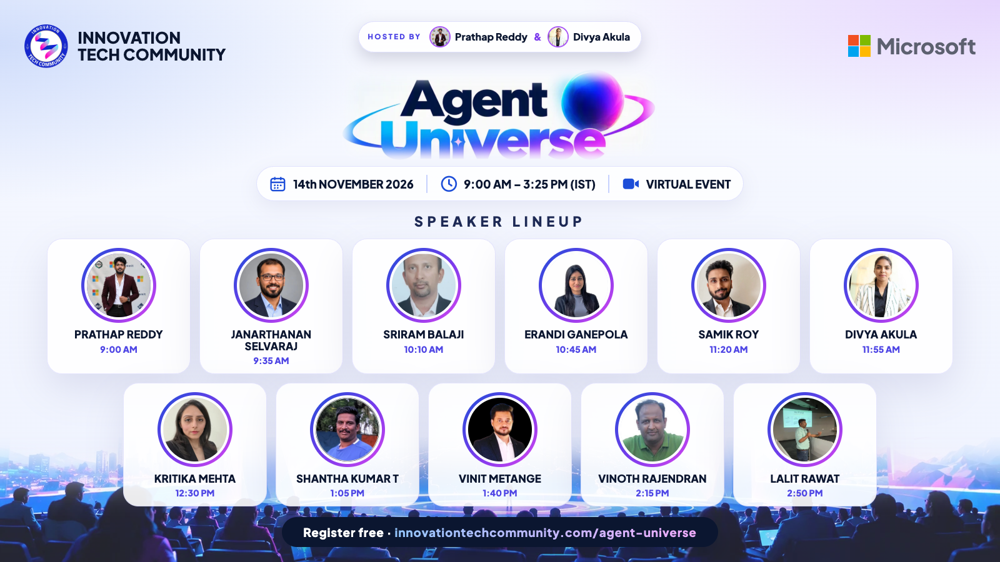

**A free, global, virtual event on Agentic AI by [Innovation Tech Community](https://innovationtechcommunity.com).**
Build · Learn · Connect · Innovate: one day of practical sessions and live demos from builders around the world.

| | |
|---|---|
| 📅 **Date** | Saturday, 14 November 2026 |
| ⏰ **Time** | 9:00 AM – 3:25 PM IST (UTC+5:30) |
| 🎤 **Lineup** | 11 sessions · 11 speakers |
| 🎙️ **Hosts** | Prathap Reddy & Divya Akula |
| 💻 **Where** | Virtual · live on YouTube and LinkedIn |
| 🎟️ **Register (free)** | https://innovationtechcommunity.com/agent-universe |
| ▶️ **YouTube live** | https://www.youtube.com/live/dGrWyDnP0PE |
| 💼 **LinkedIn live** | https://www.linkedin.com/events/7520555249288470529/ |
| 🛂 **Passport stamp** | Registered attendees can claim the Agent Universe 2026 stamp in their ITC Learning Passport |

## For speakers: how to join

| | |
|---|---|
| 🎙️ **StreamYard studio (speakers only)** | **https://streamyard.com/ctr2gy26hi** |
| ⏰ **When to join** | 15 minutes before your slot (see the schedule below). The first two speakers: 8:30 AM IST |
| 🖥️ **Your slides** | Use the [speaker template](slides/agent-universe-2026-speaker-template.pptx) (16:9, fonts of 18pt or more) |
| 🖼️ **Your banner** | Download it below, or from your speaker dashboard on the website in three sizes |

Use the StreamYard link only to join as a speaker; please don't share it. Attendees watch on YouTube or LinkedIn.

## Schedule

All times IST. Every slot is **35 minutes: a 30-minute session + 5 minutes of Q&A**.

| Time (IST) | Speaker | Session | Format |
|---|---|---|---|
| 9:00 AM – 9:35 AM | Prathap Reddy | From Idea to Agent: Building Enterprise AI Agents with Microsoft Foundry and Copilot Studio | Live demo · Intermediate |
| 9:35 AM – 10:10 AM | Janarthanan Selvaraj | Building Intelligent Enterprise AI Agents with Microsoft Foundry and Foundry IQ | Talk · Intermediate |
| 10:10 AM – 10:45 AM | Sriram Balaji | Build agents using Copilot Studio and Microsoft Foundry | Talk · Beginner |
| 10:45 AM – 11:20 AM | Erandi Ganepola | One API Endpoint Is Not One MCP Tool: Designing Business Capabilities for AI Agents | Talk · Intermediate |
| 11:20 AM – 11:55 AM | Samik Roy | Building a Secure Harness for Autonomous AI | Talk · Intermediate |
| 11:55 AM – 12:30 PM | Divya Akula | Agents That Know Their Limits: Shipping Governed Multi-Agent Systems with Copilot Studio and Azure AI | Talk · Intermediate |
| 12:30 PM – 1:05 PM | Kritika Mehta | Rethinking ERP Workflows with Multiple AI Agents: An Azure Logic Apps Experiment | Live demo · Intermediate |
| 1:05 PM – 1:40 PM | Shantha Kumar T | Beyond the Chatbot: Building Proactive AI Teammates with Copilot Studio | Live demo · Intermediate |
| 1:40 PM – 2:15 PM | Vinit Metange | Red-Team Your Agent Before Your Users Do: Testing and Securing Microsoft Foundry Agents | Talk · Beginner |
| 2:15 PM – 2:50 PM | Vinoth Rajendran | Building Smarter AI Agents with Microsoft Agent Framework Harness | Talk · Intermediate |
| 2:50 PM – 3:25 PM | Lalit Rawat | Securing AI Agents: From Autonomous Intelligence to Enterprise-Grade Trust | Talk · Intermediate |

Also available as [`schedule.csv`](schedule.csv) and a calendar file, [`agent-universe-2026.ics`](agent-universe-2026.ics).

## Speakers

| Speaker | Role | Slot |
|---|---|---|
| Prathap Reddy | AI Engineer · Sulava Mea | 9:00 AM |
| Janarthanan Selvaraj | Senior Manager · Atos | 9:35 AM |
| Sriram Balaji | Director · Kerv Digital | 10:10 AM |
| Erandi Ganepola | Lead Solutions Engineer - Solutions Architecture · WSO2 LLC | 10:45 AM |
| Samik Roy |  | 11:20 AM |
| Divya Akula | Senior Technical Consultant – AI & Microsoft Copilot Solutions · Sulava MEA | 11:55 AM |
| Kritika Mehta |  | 12:30 PM |
| Shantha Kumar T | Chief Technology Officer · SharePoint Designs | 1:05 PM |
| Vinit Metange | Product Manager | Founder · Beacon AI | AASA | 1:40 PM |
| Vinoth Rajendran | Software Developer | 2:15 PM |
| Lalit Rawat | CISO · Kanerika | 2:50 PM |

## Speaker banners

Every banner comes in three sizes: **Post** (1080 × 1350, LinkedIn and Instagram), **Story** (1080 × 1920, Instagram and WhatsApp status) and **Wide** (1600 × 900, LinkedIn, X and YouTube).
The website generates them, so the live version is always at `https://innovationtechcommunity.com/banner/<session-id>.png?size=portrait|story|landscape`.

| Banner | Session |
|---|---|
| 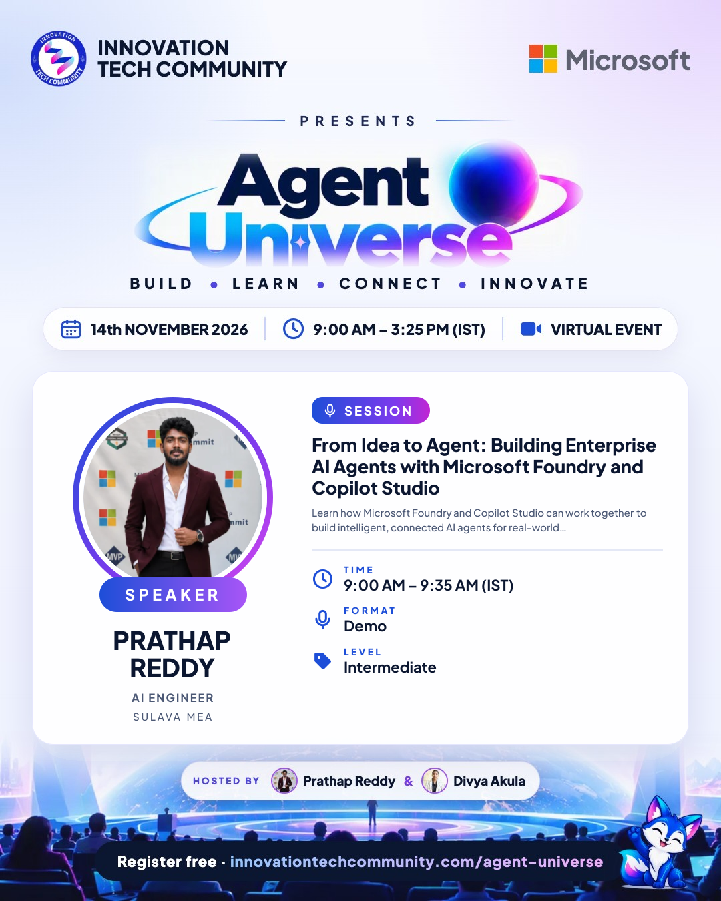 | **Prathap Reddy** 9:00 AM IST From Idea to Agent: Building Enterprise AI Agents with Microsoft Foundry and Copilot Studio [Post](banners/portrait/01-prathap-reddy.png) · [Story](banners/story/01-prathap-reddy.png) · [Wide](banners/landscape/01-prathap-reddy.png) |
| 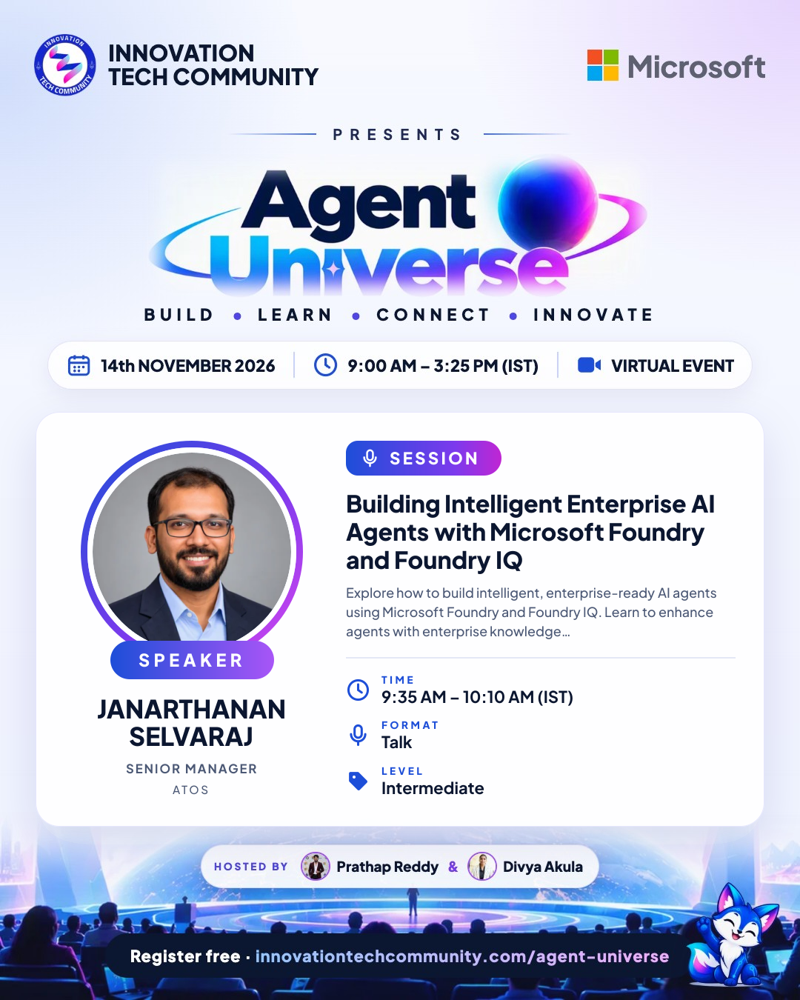 | **Janarthanan Selvaraj** 9:35 AM IST Building Intelligent Enterprise AI Agents with Microsoft Foundry and Foundry IQ [Post](banners/portrait/02-janarthanan-selvaraj.png) · [Story](banners/story/02-janarthanan-selvaraj.png) · [Wide](banners/landscape/02-janarthanan-selvaraj.png) |
| 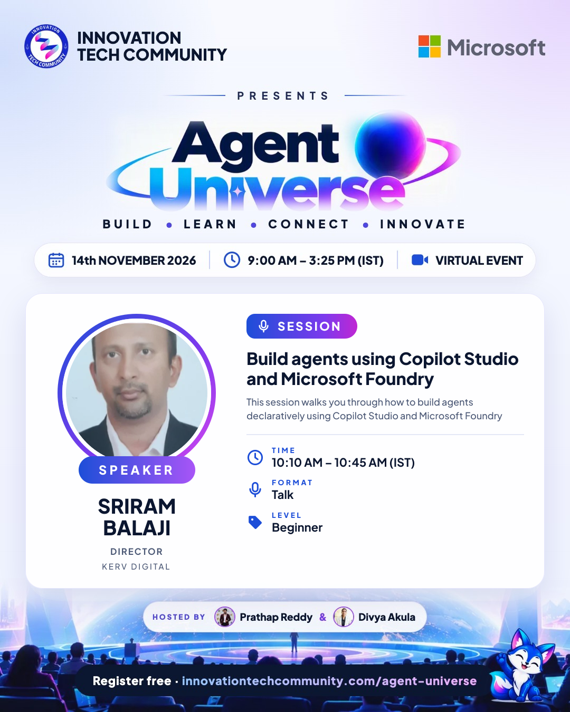 | **Sriram Balaji** 10:10 AM IST Build agents using Copilot Studio and Microsoft Foundry [Post](banners/portrait/03-sriram-balaji.png) · [Story](banners/story/03-sriram-balaji.png) · [Wide](banners/landscape/03-sriram-balaji.png) |
| 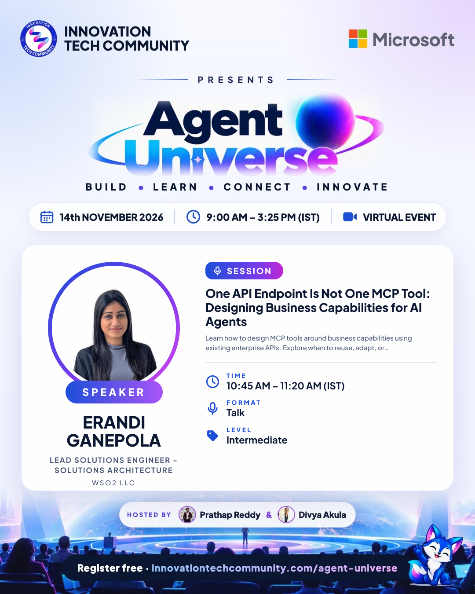 | **Erandi Ganepola** 10:45 AM IST One API Endpoint Is Not One MCP Tool: Designing Business Capabilities for AI Agents [Post](banners/portrait/04-erandi-ganepola.png) · [Story](banners/story/04-erandi-ganepola.png) · [Wide](banners/landscape/04-erandi-ganepola.png) |
| 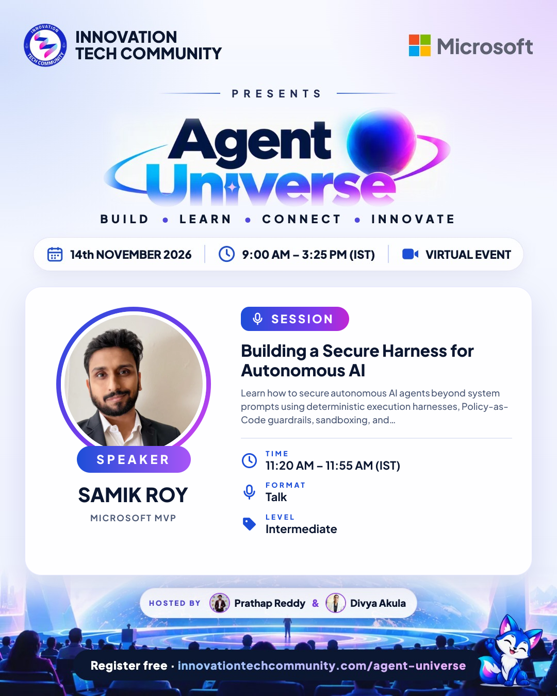 | **Samik Roy** 11:20 AM IST Building a Secure Harness for Autonomous AI [Post](banners/portrait/05-samik-roy.png) · [Story](banners/story/05-samik-roy.png) · [Wide](banners/landscape/05-samik-roy.png) |
| 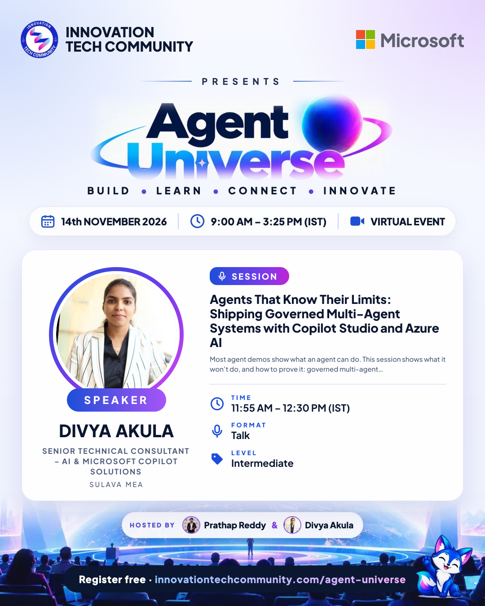 | **Divya Akula** 11:55 AM IST Agents That Know Their Limits: Shipping Governed Multi-Agent Systems with Copilot Studio and Azure AI [Post](banners/portrait/06-divya-akula.png) · [Story](banners/story/06-divya-akula.png) · [Wide](banners/landscape/06-divya-akula.png) |
| 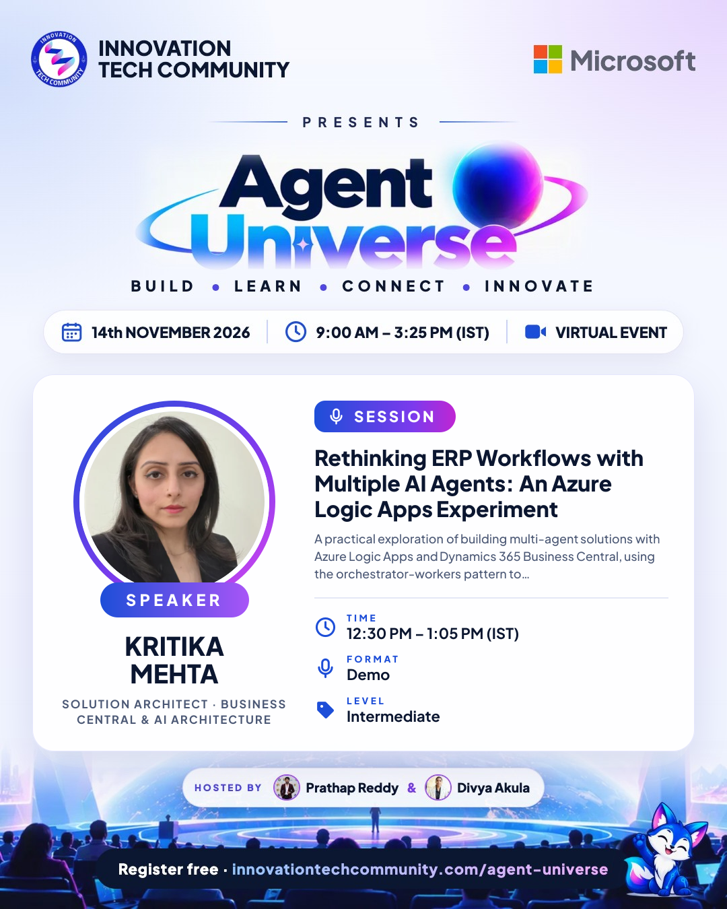 | **Kritika Mehta** 12:30 PM IST Rethinking ERP Workflows with Multiple AI Agents: An Azure Logic Apps Experiment [Post](banners/portrait/07-kritika-mehta.png) · [Story](banners/story/07-kritika-mehta.png) · [Wide](banners/landscape/07-kritika-mehta.png) |
| 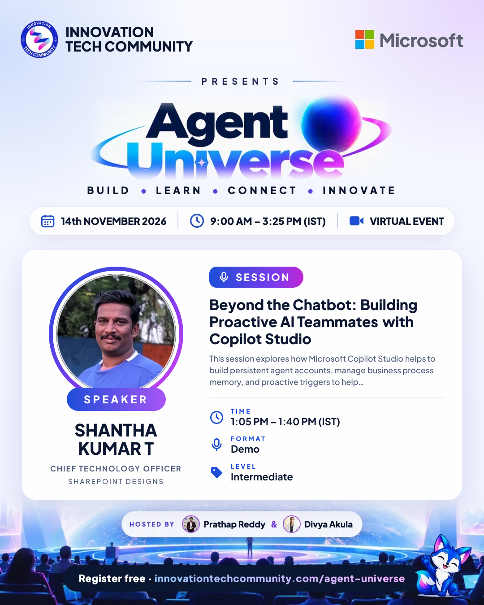 | **Shantha Kumar T** 1:05 PM IST Beyond the Chatbot: Building Proactive AI Teammates with Copilot Studio [Post](banners/portrait/08-shantha-kumar-t.png) · [Story](banners/story/08-shantha-kumar-t.png) · [Wide](banners/landscape/08-shantha-kumar-t.png) |
| 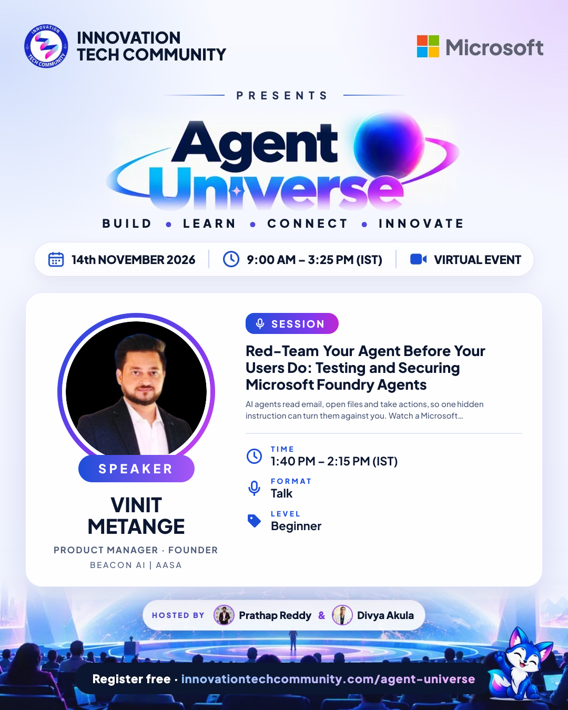 | **Vinit Metange** 1:40 PM IST Red-Team Your Agent Before Your Users Do: Testing and Securing Microsoft Foundry Agents [Post](banners/portrait/09-vinit-metange.png) · [Story](banners/story/09-vinit-metange.png) · [Wide](banners/landscape/09-vinit-metange.png) |
| 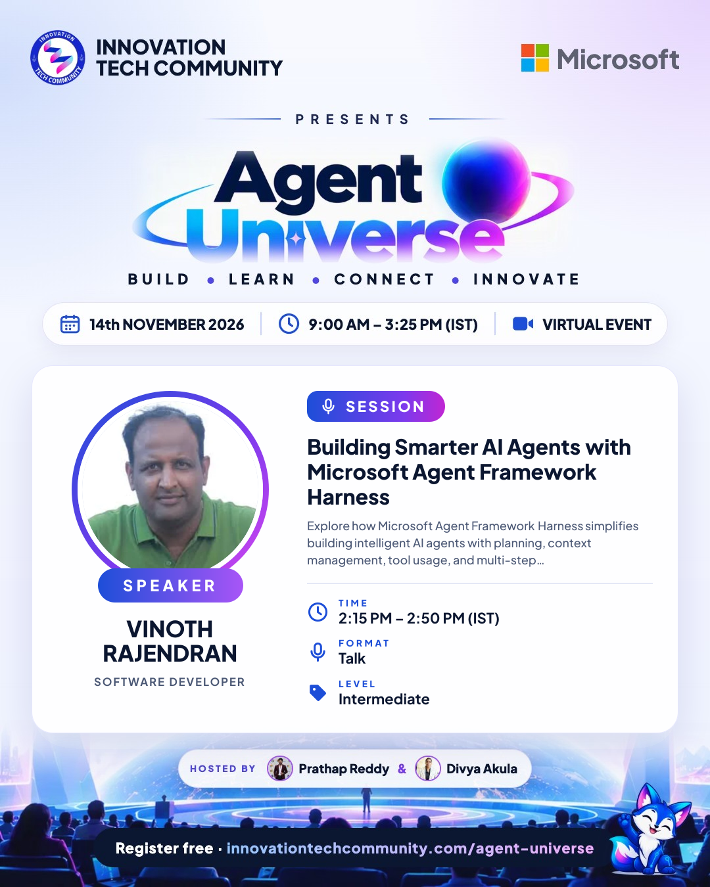 | **Vinoth Rajendran** 2:15 PM IST Building Smarter AI Agents with Microsoft Agent Framework Harness [Post](banners/portrait/10-vinoth-rajendran.png) · [Story](banners/story/10-vinoth-rajendran.png) · [Wide](banners/landscape/10-vinoth-rajendran.png) |
| 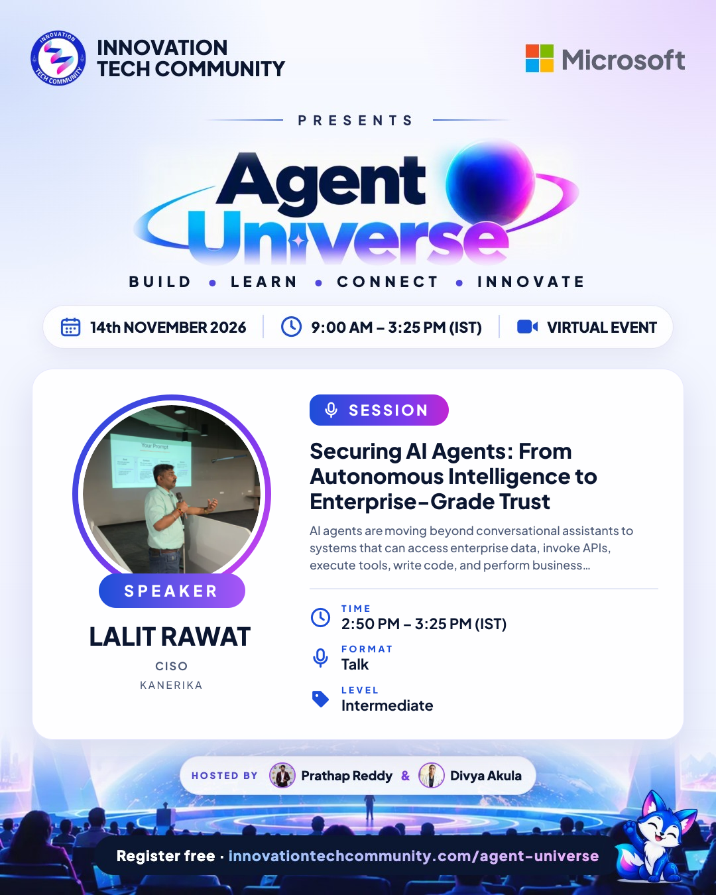 | **Lalit Rawat** 2:50 PM IST Securing AI Agents: From Autonomous Intelligence to Enterprise-Grade Trust [Post](banners/portrait/11-lalit-rawat.png) · [Story](banners/story/11-lalit-rawat.png) · [Wide](banners/landscape/11-lalit-rawat.png) |

## Posters

| File | Size |
|---|---|
| [`posters/agent-universe-poster-portrait.png`](posters/agent-universe-poster-portrait.png) | Event poster · 1080 × 1350 |
| [`posters/agent-universe-poster-story.png`](posters/agent-universe-poster-story.png) | Event poster · 1080 × 1920 |
| [`posters/agent-universe-lineup-portrait.png`](posters/agent-universe-lineup-portrait.png) | Speaker lineup · 1080 × 1350 |
| [`posters/agent-universe-lineup-story.png`](posters/agent-universe-lineup-story.png) | Speaker lineup · 1080 × 1920 |
| [`posters/agent-universe-lineup-landscape.png`](posters/agent-universe-lineup-landscape.png) | Speaker lineup · 1600 × 900 |
| [`posters/agent-universe-agenda-story.png`](posters/agent-universe-agenda-story.png) | Agenda · 1080 × 1920 |

## Slides

| File | What it is |
|---|---|
| [`slides/agent-universe-2026-speaker-template.pptx`](slides/agent-universe-2026-speaker-template.pptx) | Branded slide template for speakers: title, about me, agenda, section divider, text and picture, code or demo, key takeaways and thank-you layouts |
| [`slides/agent-universe-2026-host-deck.pptx`](slides/agent-universe-2026-host-deck.pptx) | Host deck for Prathap Reddy & Divya Akula: welcome, your hosts, housekeeping, about ITC, the day at a glance, agenda, one intro slide per session (a ~2-minute intro script and the presenting host in the speaker notes) and the closing slide |

To rebuild the images and decks after a change, see [`tools/README.md`](tools/README.md).

## Run of show

See [`run-of-show.md`](run-of-show.md) for the hosts' checklist and who introduces each slot.

## Registrations

Registrations are managed on the website (Admin › Events & speakers › Agent Universe 2026 › Registrations, with CSV export).
**Attendee details are personal data and are never stored in this repository.**

---

Innovation Tech Community · Learn together. Build together. Grow together. · #AgentUniverse2026
